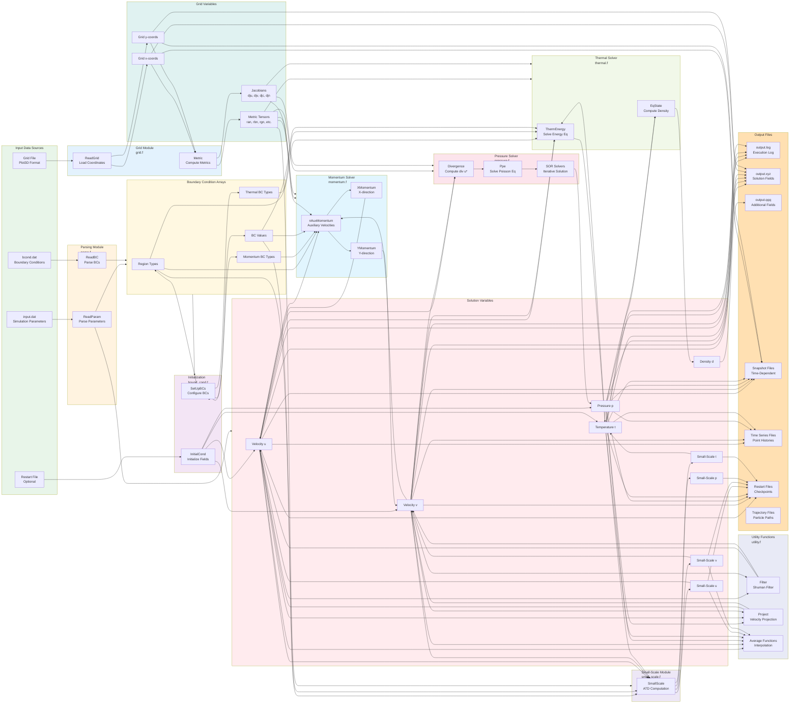

# Data Flow Diagram

This diagram illustrates how data flows through the wolfd2 program, from input files through processing to output files.

## Data Flow Description

### Input Phase

1. **Parameter Files** → `ReadParam` → Solution variables, flags, tolerances
2. **Boundary Condition File** → `ReadBC` → Boundary condition arrays
3. **Grid File** → `ReadGrid` → Grid coordinates
4. **Restart File** (optional) → `InitialCond` → Initial solution fields

### Processing Phase

1. **Grid Coordinates** → `Metric` → Metric tensors and Jacobians
2. **Solution Variables + Metrics + BCs** → `nAuxMomentum` → Updated velocities
3. **Velocities** → `Filter` → Filtered velocities (optional)
4. **Velocities** → `Divergence` → Divergence field
5. **Divergence + Metrics** → `Ppe` → Pressure field
6. **Pressure + Velocities** → `Project` → Divergence-free velocities
7. **Velocities + Temperature** → `ThermEnergy` → Updated temperature
8. **Pressure + Temperature** → `EqState` → Density field
9. **Velocities + Temperature** → `SmallScale` → Small-scale fields
10. **Small-Scale Fields** → Added to large-scale fields

### Output Phase

1. **Solution Variables** → Various output routines → Output files
2. **Grid Coordinates** → Included in solution output files
3. **Time-Averaged Quantities** → Post-processed and saved separately

## Key Data Transformations

- **Grid → Metrics**: Physical coordinates → Computational metrics
- **Velocities → Auxiliary Velocities**: Through momentum equations
- **Auxiliary Velocities → Pressure**: Through Poisson equation
- **Auxiliary Velocities + Pressure → Divergence-Free Velocities**: Through projection
- **Large-Scale + Small-Scale → Complete Solution**: Through ATD decomposition

