# Module Architecture Diagram

This diagram shows the module dependencies and call relationships in the wolfd2 program.

```mermaid
graph TB
    subgraph Main["main.f<br/>Main Program"]
        MainProg[wolfd2<br/>Entry Point]
    end
    
    subgraph Parse["parse.f<br/>Input Parsing"]
        ReadParam[ReadParam]
        ReadIPFile[lReadIPFile]
        ReadBCFile[lReadBCFile]
    end
    
    subgraph Grid["grid.f<br/>Grid Processing"]
        GridSub[Grid]
        ReadGrid[ReadGrid]
        MirrorPts[MirrorPts]
        FullGrid[FullGrid]
        Metric[Metric]
        CheckGridSize[CheckGridSize]
    end
    
    subgraph BC["bound_cond.f<br/>Boundary Conditions"]
        SetupBC[SetUpBCs]
        InitialCond[InitialCond]
        VelBoundCond[VelBoundCond]
        PresBoundCond[PresBoundCond]
        TempBoundCond[TempBoundCond]
        SmlSclBC[SmlSclBC]
        VelOutflowBCs[VelOutflowBCs]
    end
    
    subgraph Momentum["momentum.f<br/>Momentum Equations"]
        AuxMom[nAuxMomentum]
        XMom[XMomentum]
        YMom[YMomentum]
        ConvCoef[ConvCoef]
        DConvU[DConvU]
        DConvV[DConvV]
        DDiffU[DDiffU]
        DDiffV[DDiffV]
        PorosCoef[PorosCoef]
        TridLU[TridLU]
        AltTridLU[AltTridLU]
    end
    
    subgraph Pressure["pressure.f<br/>Pressure Solver"]
        PPE[Ppe]
        Divergence[Divergence]
        RhsPpe[RhsPpe]
        Sor[Sor]
        SorRB[SorRB]
        SorRBP[SorRBP]
        Slor[Slor]
        SlorRB[SlorRB]
        SlorRBP[SlorRBP]
    end
    
    subgraph Thermal["thermal.f<br/>Thermal Energy"]
        ThermEnergy[ThermEnergy]
        EqState[EqState]
    end
    
    subgraph SmallScale["small_scale.f<br/>ATD Modeling"]
        SmallScaleFunc[SmallScale]
    end
    
    subgraph Traject["traject.f<br/>Particle Tracking"]
        InitTraject[InitTraject]
        TrajectFunc[Traject]
        FwdEuler[FwdEuler]
        HeunTrap[HeunTrap]
        TrajFunc[TrajFunc]
        TrajJac[TrajJac]
        FindPos[FindPos]
        BiLinInterp[BiLinInterp]
        Gauss[Gauss]
    end
    
    subgraph Utility["utility.f<br/>Utility Functions"]
        Filter[Filter]
        Project[Project]
        PTDAvg[PTDAvg]
        VelAvg[VelAvg]
        TAveraged[TAveraged]
    end
    
    subgraph FileManip["file_manip.f<br/>File I/O"]
        SaveSolution[SaveSolution]
        SaveGrid2DP3D[SaveGrid2DP3D]
        SaveRestart[SaveRestart]
        ReadRestart[ReadRestart]
        SaveFunc[SaveFunc]
        SaveTraject[SaveTraject]
        SaveFullSol[SaveFullSol]
        SaveTimeSrs[SaveTimeSrs]
        SaveTmAvgP3D[SaveTmAvgP3D]
        SaveStdVarsP3D[SaveStdVarsP3D]
    end
    
    subgraph String["string.f<br/>String Utilities"]
        ToLower[mToLowerC]
        ToUpper[mToUpperC]
        InitStr[mInitStr]
        SyntaxError[SyntaxError]
        PrintTitle[PrintTitle]
        PrintDiff[PrintDiff]
        LogInputPar[LogInputPar]
    end
    
    MainProg --> ReadParam
    MainProg --> GridSub
    MainProg --> SetupBC
    MainProg --> InitialCond
    MainProg --> AuxMom
    MainProg --> PPE
    MainProg --> Project
    MainProg --> ThermEnergy
    MainProg --> SmallScaleFunc
    MainProg --> InitTraject
    MainProg --> TrajectFunc
    MainProg --> SaveStdVarsP3D
    MainProg --> SaveRestart
    MainProg --> SaveTimeSrs
    MainProg --> SaveTraject
    MainProg --> SaveTmAvgP3D
    MainProg --> PrintTitle
    MainProg --> LogInputPar
    MainProg --> PrintDiff
    
    ReadParam --> ReadIPFile
    ReadParam --> ReadBCFile
    ReadParam --> ToLower
    ReadParam --> ToUpper
    ReadParam --> InitStr
    ReadParam --> SyntaxError
    
    GridSub --> ReadGrid
    GridSub --> MirrorPts
    GridSub --> FullGrid
    GridSub --> Metric
    GridSub --> CheckGridSize
    
    SetupBC --> VelBoundCond
    SetupBC --> PresBoundCond
    SetupBC --> TempBoundCond
    SetupBC --> ToLower
    SetupBC --> SyntaxError
    
    InitialCond --> ReadRestart
    InitialCond --> VelBoundCond
    InitialCond --> PresBoundCond
    
    AuxMom --> XMom
    AuxMom --> YMom
    AuxMom --> VelOutflowBCs
    AuxMom --> TridLU
    AuxMom --> AltTridLU
    
    XMom --> ConvCoef
    XMom --> DConvU
    XMom --> DDiffU
    XMom --> PorosCoef
    XMom --> TridLU
    
    YMom --> ConvCoef
    YMom --> DConvV
    YMom --> DDiffV
    YMom --> PorosCoef
    YMom --> TridLU
    
    PPE --> Divergence
    PPE --> RhsPpe
    PPE --> Sor
    PPE --> SorRB
    PPE --> SorRBP
    PPE --> Slor
    PPE --> SlorRB
    PPE --> SlorRBP
    
    Sor --> AltTridLU
    SorRB --> AltTridLU
    SorRBP --> AltTridLU
    Slor --> AltTridLU
    SlorRB --> AltTridLU
    SlorRBP --> AltTridLU
    
    SmallScaleFunc --> PPE
    SmallScaleFunc --> Project
    SmallScaleFunc --> SmlSclBC
    SmallScaleFunc --> Filter
    SmallScaleFunc --> VelBoundCond
    SmallScaleFunc --> PresBoundCond
    SmallScaleFunc --> TempBoundCond
    
    TrajectFunc --> FwdEuler
    TrajectFunc --> HeunTrap
    TrajectFunc --> FindPos
    TrajectFunc --> BiLinInterp
    TrajectFunc --> VelAvg
    
    HeunTrap --> TrajFunc
    HeunTrap --> TrajJac
    HeunTrap --> Gauss
    
    SaveStdVarsP3D --> SaveGrid2DP3D
    SaveStdVarsP3D --> SaveFunc
    SaveStdVarsP3D --> VelAvg
    SaveStdVarsP3D --> PTDAvg
    SaveStdVarsP3D --> TAveraged
    
    SaveTimeSrs --> SaveFunc
    
    SaveTmAvgP3D --> SaveGrid2DP3D
    SaveTmAvgP3D --> SaveFunc
    
    style Main fill:#FFE0B2
    style Parse fill:#C8E6C9
    style Grid fill:#BBDEFB
    style BC fill:#E1BEE7
    style Momentum fill:#B3E5FC
    style Pressure fill:#F8BBD0
    style Thermal fill:#DCEDC8
    style SmallScale fill:#D1C4E9
    style Traject fill:#FFCCBC
    style Utility fill:#C5CAE9
    style FileManip fill:#FFE082
    style String fill:#F5F5F5
```

## Module Dependency Levels

### Level 0: Core Modules (No Dependencies)
- **string.f**: String manipulation utilities (used by all)
- **utility.f**: Core utility functions (filtering, projection, averaging)

### Level 1: Input/Grid Modules
- **parse.f**: Input parsing (depends on string.f)
- **grid.f**: Grid processing (standalone)

### Level 2: Boundary Condition Module
- **bound_cond.f**: Boundary conditions (depends on string.f, file_manip.f)

### Level 3: Solver Modules
- **momentum.f**: Momentum equations (depends on utility.f, bound_cond.f)
- **pressure.f**: Pressure solver (depends on momentum.f for AltTridLU)
- **thermal.f**: Thermal energy (depends on utility.f, bound_cond.f)

### Level 4: Advanced Modules
- **small_scale.f**: ATD modeling (depends on pressure.f, utility.f, bound_cond.f)
- **traject.f**: Particle tracking (depends on utility.f)

### Level 5: File I/O Module
- **file_manip.f**: File operations (depends on utility.f, string.f)

### Level 6: Main Program
- **main.f**: Orchestrates all modules

## Call Hierarchy

1. **main.f** calls all major modules
2. **Solver modules** (momentum, pressure, thermal) are called from main
3. **Boundary condition routines** are called from multiple modules
4. **Utility functions** are used throughout the codebase
5. **File I/O routines** are called from main for output operations

## Key Relationships

- **momentum.f ↔ pressure.f**: Momentum provides tridiagonal solvers used by pressure
- **pressure.f ↔ utility.f**: Pressure uses Project from utility
- **small_scale.f ↔ pressure.f**: Small-scale uses same pressure solver
- **bound_cond.f ↔ all solvers**: All solvers need boundary conditions
- **file_manip.f ↔ utility.f**: File I/O uses averaging functions

