# Program Flow Diagram

This diagram shows the overall execution flow of the wolfd2 program from startup to completion.

```mermaid
flowchart TD
    Start([Program Start]) --> ReadParams[Read Input Parameters<br/>ReadParam]
    ReadParams --> LogInit[Initialize Log File]
    LogInit --> ReadGrid[Read Grid File<br/>Grid]
    ReadGrid --> SetupBC[Setup Boundary Conditions<br/>SetUpBCs]
    SetupBC --> CheckTraj{Trajectory<br/>Enabled?}
    CheckTraj -->|Yes| InitTraj[Initialize Trajectories<br/>InitTraject]
    CheckTraj -->|No| CheckRestart
    InitTraj --> CheckRestart{Restart?}
    CheckRestart -->|No| InitCold[Initialize Cold Start<br/>InitialCond]
    CheckRestart -->|Yes| InitRestart[Read Restart File<br/>InitialCond]
    InitCold --> EnforceMass[Enforce Mass Conservation<br/>Ppe + Project]
    InitRestart --> CheckSmall{Small-Scale<br/>Enabled?}
    EnforceMass --> CheckSmall
    CheckSmall -->|Yes| InitSmall[Initialize Small-Scale<br/>SmallScale]
    CheckSmall -->|No| TimeLoop
    InitSmall --> TimeLoop[Time Stepping Loop<br/>k = 1 to nts]
    
    TimeLoop --> SavePrev[Save Previous Time Level<br/>un=u, vn=v, pn=p, tn=t]
    SavePrev --> CheckSmall2{Small-Scale<br/>Enabled?}
    CheckSmall2 -->|Yes| AddSmall[Add Small-Scale to<br/>Previous Time Level]
    CheckSmall2 -->|No| MEIter
    AddSmall --> MEIter[Momentum-Energy<br/>Iterations Loop]
    
    MEIter --> InitStar[Initialize Starred Variables<br/>us=u, vs=v, ts=t]
    InitStar --> AuxMom[Solve Auxiliary Momentum<br/>nAuxMomentum]
    AuxMom --> FilterU{Filter U?}
    FilterU -->|Yes| FilterUOp[Apply Shuman Filter<br/>Filter u-component]
    FilterU -->|No| FilterV
    FilterUOp --> FilterV{Filter V?}
    FilterV -->|Yes| FilterVOp[Apply Shuman Filter<br/>Filter v-component]
    FilterV -->|No| VelBC1
    FilterVOp --> VelBC1[Apply Velocity BCs<br/>VelBoundCond]
    VelBC1 --> PresBC1[Apply Pressure BCs<br/>PresBoundCond]
    PresBC1 --> SolvePPE[Solve Pressure Poisson Eq<br/>Ppe]
    SolvePPE --> PresBC2[Apply Pressure BCs<br/>PresBoundCond]
    PresBC2 --> Project[Project Velocities<br/>Project]
    Project --> VelBC2[Apply Velocity BCs<br/>VelBoundCond]
    VelBC2 --> PresBC3[Apply Pressure BCs<br/>PresBoundCond]
    PresBC3 --> CheckTherm{Thermal<br/>Enabled?}
    CheckTherm -->|Yes| ThermEnergy[Solve Thermal Energy<br/>ThermEnergy]
    CheckTherm -->|No| CheckEOS
    ThermEnergy --> CheckEOS{Equation of<br/>State?}
    CheckEOS -->|Yes| EqState[Compute Density<br/>EqState]
    CheckEOS -->|No| CheckConv
    EqState --> CheckConv[Check Convergence]
    CheckConv -->|Not Converged| MEIter
    CheckConv -->|Converged| FilterT
    
    FilterT{Thermal &<br/>Filter T?}
    FilterT -->|Yes| FilterTOp[Apply Shuman Filter<br/>Filter t-component]
    FilterT -->|No| CheckSmall3
    FilterTOp --> CheckSmall3{Small-Scale<br/>Enabled?}
    CheckSmall3 -->|Yes| ComputeSmall[Compute Small-Scale<br/>SmallScale]
    CheckSmall3 -->|No| ApplyBCs
    ComputeSmall --> AddSmall2[Add Small-Scale to<br/>Large-Scale Fields]
    AddSmall2 --> ApplyBCs[Apply All Boundary Conditions]
    
    ApplyBCs --> CheckDiff[Check Solution Differences]
    CheckDiff --> CheckDiv{Diverged?}
    CheckDiv -->|Yes| StopDiv[Stop: Solution Diverged]
    CheckDiv -->|No| OutputOps[Output Operations]
    
    OutputOps --> CheckTS{Time Series<br/>Output?}
    CheckTS -->|Yes| SaveTS[Save Time Series<br/>SaveTimeSrs]
    CheckTS -->|No| CheckSnap
    SaveTS --> CheckSnap{Snapshots<br/>Enabled?}
    CheckSnap -->|Yes| SaveSnap[Save Snapshot<br/>SaveStdVarsP3D]
    CheckSnap -->|No| CheckRestart
    SaveSnap --> CheckRestart{Checkpoint<br/>Restart?}
    CheckRestart -->|Yes| SaveRestart[Save Restart File<br/>SaveRestart]
    CheckRestart -->|No| CheckTraj2
    SaveRestart --> CheckTraj2{Trajectory<br/>Enabled?}
    CheckTraj2 -->|Yes| IntegrateTraj[Integrate Trajectories<br/>Traject]
    CheckTraj2 -->|No| CheckTimeAvg
    IntegrateTraj --> SaveTraj{Save<br/>Trajectory?}
    SaveTraj -->|Yes| SaveTrajFile[Save Trajectory File<br/>SaveTraject]
    SaveTraj -->|No| CheckTimeAvg
    SaveTrajFile --> CheckTimeAvg{Time<br/>Averaging?}
    CheckTimeAvg -->|Yes| AccumAvg[Accumulate Time-Averaged<br/>Quantities]
    CheckTimeAvg -->|No| CheckLoop
    AccumAvg --> CheckLoop{More Time<br/>Steps?}
    CheckLoop -->|Yes| TimeLoop
    CheckLoop -->|No| FinalOutput
    
    FinalOutput[Final Output Operations] --> SaveFinal[Save Final Solution<br/>SaveStdVarsP3D]
    SaveFinal --> CheckTimeAvg2{Time<br/>Averaging?}
    CheckTimeAvg2 -->|Yes| ProcessAvg[Process Time-Averaged<br/>Quantities]
    CheckTimeAvg2 -->|No| CloseFiles
    ProcessAvg --> SaveAvg[Save Time-Averaged<br/>SaveTmAvgP3D]
    SaveAvg --> CloseFiles[Close Files]
    CloseFiles --> End([Program End])
    
    StopDiv --> End
    
    style Start fill:#90EE90
    style End fill:#FFB6C1
    style TimeLoop fill:#87CEEB
    style MEIter fill:#DDA0DD
    style StopDiv fill:#FF6B6B
```

## Key Flow Points

1. **Initialization**: Program reads parameters, sets up grid, and initializes solution
2. **Time Stepping Loop**: Main computational loop for each time step
3. **Momentum-Energy Iterations**: Inner loop for coupling momentum and energy equations
4. **Output Operations**: Various output options (snapshots, time series, restart files)
5. **Final Processing**: Final solution output and time-averaging post-processing

## Conditional Paths

- **Restart**: Can start from previous solution or cold start
- **Small-Scale**: Optional ATD turbulence modeling
- **Thermal**: Optional thermal energy equation
- **Trajectories**: Optional particle tracking
- **Time Averaging**: Optional statistical post-processing

