# Time-Step Algorithm Diagram

This diagram shows the detailed algorithm for a single time step, including the momentum-energy iteration cycle and the projection method.

```mermaid
flowchart TD
    Start([Time Step k]) --> SaveTimeN[Save Time Level n<br/>un = u, vn = v<br/>pn = p, tn = t]
    SaveTimeN --> CheckSmall1{Small-Scale<br/>Enabled?}
    CheckSmall1 -->|Yes| SaveSmallN[Save Small-Scale n<br/>usn = uss, vsn = vss<br/>tsn = tss]
    CheckSmall1 -->|No| AddSmall1
    SaveSmallN --> AddSmall1[Add Small-Scale to<br/>Previous Time Level<br/>un = un + uss<br/>vn = vn + vss<br/>tn = tn + tss]
    AddSmall1 --> InitMEIter[Momentum-Energy<br/>Iterations: l = 1 to nmeiter]
    
    InitMEIter --> InitStar[Initialize Starred<br/>us = u, vs = v, ts = t]
    InitStar --> QLIter[Quasilinearization<br/>Iterations: m = 1 to mqiter]
    
    QLIter --> InitDelta[Initialize Deltas<br/>dus = 0, dvs = 0]
    InitDelta --> XSweep[X-Momentum Sweep<br/>Douglas-Gunn ADI<br/>Solve for dus]
    XSweep --> YSweep[Y-Momentum Sweep<br/>Douglas-Gunn ADI<br/>Solve for dvs]
    YSweep --> UpdateStar[Update Starred<br/>us = us + dus<br/>vs = vs + dvs]
    UpdateStar --> OutflowBC[Apply Outflow BCs<br/>VelOutflowBCs]
    OutflowBC --> CheckQLConv{QL<br/>Converged?}
    CheckQLConv -->|No| QLIter
    CheckQLConv -->|Yes| FilterU{Filter U?}
    
    FilterU -->|Yes| FilterUOp[Shuman Filter u<br/>Filter us]
    FilterU -->|No| FilterV
    FilterUOp --> FilterV{Filter V?}
    FilterV -->|Yes| FilterVOp[Shuman Filter v<br/>Filter vs]
    FilterV -->|No| VelBC1
    FilterVOp --> VelBC1[Apply Velocity BCs<br/>VelBoundCond us, vs]
    VelBC1 --> PresBC1[Apply Pressure BCs<br/>PresBoundCond p]
    PresBC1 --> ComputeDiv[Compute Divergence<br/>div = div us, vs]
    ComputeDiv --> BuildPPE[Build PPE Matrix<br/>A p = div / dt]
    BuildPPE --> SolvePPE[SOR Iterations<br/>Solve for p]
    SolvePPE --> PresBC2[Apply Pressure BCs<br/>PresBoundCond p]
    PresBC2 --> Project[Project Velocities<br/>u = us - grad p / dt<br/>v = vs - grad p / dt]
    Project --> VelBC2[Apply Velocity BCs<br/>VelBoundCond u, v]
    VelBC2 --> PresBC3[Apply Pressure BCs<br/>PresBoundCond p]
    PresBC3 --> CheckTherm{Thermal<br/>Enabled?}
    
    CheckTherm -->|Yes| ThermSolve[Solve Thermal Energy<br/>ADI Method<br/>Update ts]
    CheckTherm -->|No| CheckEOS
    ThermSolve --> CheckEOS{Equation of<br/>State?}
    CheckEOS -->|Yes| ComputeDensity[Compute Density<br/>d = f p, ts]
    CheckEOS -->|No| CheckMEConv
    ComputeDensity --> CheckMEConv[Check ME<br/>Convergence<br/>dif = max u-us, v-vs, t-ts]
    CheckMEConv -->|Not Converged| UpdateME[Update Variables<br/>u = us, v = vs, t = ts]
    UpdateME --> InitMEIter
    CheckMEConv -->|Converged| FilterT
    
    FilterT{Thermal &<br/>Filter T?}
    FilterT -->|Yes| FilterTOp[Shuman Filter t<br/>Filter t]
    FilterT -->|No| CheckSmall2
    FilterTOp --> CheckSmall2{Small-Scale<br/>Enabled?}
    
    CheckSmall2 -->|Yes| SubSmall[Subtract Small-Scale n<br/>u = u - usn<br/>v = v - vsn<br/>t = t - tsn]
    CheckSmall2 -->|No| ApplyBCs
    SubSmall --> SmallScaleSolve[Solve Small-Scale<br/>ATD Computation<br/>Update uss, vss, pss, tss]
    SmallScaleSolve --> AddSmall2[Add Small-Scale<br/>u = u + uss<br/>v = v + vss<br/>t = t + tss]
    AddSmall2 --> ApplyBCs[Apply All BCs<br/>VelBoundCond u, v<br/>PresBoundCond p<br/>TempBoundCond t]
    
    ApplyBCs --> CheckDiff[Check Differences<br/>dif = max pn-p, un-u, vn-v, tn-t]
    CheckDiff --> CheckDiv{Solution<br/>Diverged?}
    CheckDiv -->|Yes| StopDiv[Stop: Divergence]
    CheckDiv -->|No| Output[Output Operations]
    
    Output --> CheckTS{Time Series?}
    CheckTS -->|Yes| SaveTS[Save Time Series<br/>SaveTimeSrs]
    CheckTS -->|No| CheckSnap
    SaveTS --> CheckSnap{Snapshots?}
    CheckSnap -->|Yes| SaveSnap[Save Snapshot<br/>SaveStdVarsP3D]
    CheckSnap -->|No| CheckRestart
    SaveSnap --> CheckRestart{Checkpoint?}
    CheckRestart -->|Yes| SaveRestart[Save Restart<br/>SaveRestart]
    CheckRestart -->|No| CheckTraj
    SaveRestart --> CheckTraj{Trajectories?}
    CheckTraj -->|Yes| IntegrateTraj[Integrate Trajectories<br/>Traject]
    CheckTraj -->|No| CheckTimeAvg
    IntegrateTraj --> SaveTraj{Save Traj?}
    SaveTraj -->|Yes| SaveTrajFile[Save Trajectory<br/>SaveTraject]
    SaveTraj -->|No| CheckTimeAvg
    SaveTrajFile --> CheckTimeAvg{Time Avg?}
    CheckTimeAvg -->|Yes| AccumAvg[Accumulate Averages]
    CheckTimeAvg -->|No| NextStep
    AccumAvg --> NextStep{More Steps?}
    NextStep -->|Yes| Start
    NextStep -->|No| End([End Time Step])
    
    StopDiv --> End
    
    style Start fill:#90EE90
    style End fill:#FFB6C1
    style InitMEIter fill:#DDA0DD
    style QLIter fill:#FFD700
    style Project fill:#87CEEB
    style SmallScaleSolve fill:#DDA0DD
    style StopDiv fill:#FF6B6B
```



## Algorithm Details

### Projection Method (Gresho's Method)

The projection method enforces incompressibility through three steps:

1. **Auxiliary Velocity Calculation**
   ```
   Solve: ∂u*/∂t + (u·∇)u* = ν∇²u* + f
   (without pressure gradient)
   ```

2. **Pressure Poisson Equation**
   ```
   Solve: ∇²p = (1/Δt) ∇·u*
   ```

3. **Velocity Projection**
   ```
   Update: u = u* - (Δt/ρ) ∇p
   ```

### Douglas-Gunn ADI Method

The momentum equations are solved using ADI time-splitting:

1. **X-Sweep (Implicit in i-direction)**
   ```
   (I - Δt/2 Lx) dus = RHS
   Solve tridiagonal systems for each j-line
   ```

2. **Y-Sweep (Implicit in j-direction)**
   ```
   (I - Δt/2 Ly) dvs = RHS
   Solve tridiagonal systems for each i-line
   ```

### Momentum-Energy Iterations

The momentum and energy equations are coupled through an iterative process:

1. Solve momentum equations → get velocities
2. Solve pressure equation → get pressure
3. Project velocities → enforce incompressibility
4. Solve thermal equation → get temperature
5. Check convergence → repeat if needed

### Small-Scale ATD Algorithm

When ATD is enabled:

1. **Decomposition**: u = u_large + u_small
2. **Large-Scale**: Solved by main algorithm
3. **Small-Scale**: Computed separately using chaotic maps
4. **Recombination**: Add small-scale to large-scale

## Convergence Criteria

- **Quasilinearization**: Convergence of dus and dvs
- **Momentum-Energy**: Convergence of u, v, t between iterations
- **Pressure SOR**: Convergence of pressure field
- **Time Step**: Check for solution divergence

## Key Operations

- **Filtering**: Shuman filter applied to control aliasing
- **Boundary Conditions**: Applied at multiple stages
- **Projection**: Enforces divergence-free velocity field
- **Output**: Various output options at each time step

